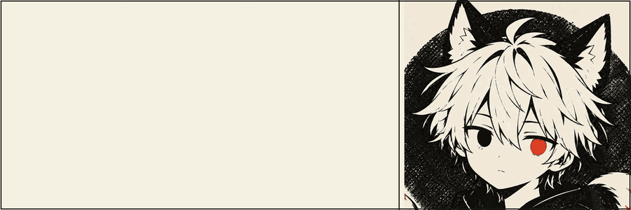

  

  
  
  

  <strong>笙锤烨 · Sentryea</strong> 
  多了解一点总不会有错吧！！。

---

## About me

`a researcher, engineer, designer, and musician (pretend to be).`

Use an engineering approach to break down problems—creating music, writing code, building hardware, and generating visuals—thereby transforming as-yet-unnamed ideas into things that can be seen, heard, and touched.

---

## Three Ways

<table>
  <tr>
    <td width="33.33%" valign="top">
      <h3>笙 · Expression</h3>
      
Music, emotion, imagination. Using sound and imagery, transforming feelings into a form that can be shared.

    </td>
    <td width="33.33%" valign="top">
      <h3>锤 · Building</h3>
      
Code, hardware, experiments. Take a problem apart, then reassemble it in your own way.

    </td>
    <td width="33.33%" valign="top">
      <h3>烨 · Existence</h3>
      
Personal growth, independent exploration. Along ever-shifting boundaries, leaving behind traces that belong solely to this observer.

    </td>
  </tr>
</table>

---

## What's going on

- 🎓**Academic**: Xi'an Jiaotong University · Industrial Design & Mecanical Engineering
- 🌱**Content**：CAD · CG · AI · Embedded Systems · 3D Art & Design
- 🎵**Life**：Music · Singing · Locking · Photography

---

## GitHub Preview

  
  

  

---

## 技术栈

  

---

## Contact

If you’re interested in collaborating on games, video projects, or research experiments—or if you simply want to chat about what’s currently going on—feel free to reach out.

  
  

---

  <picture>
    <source media="(prefers-color-scheme: dark)" srcset="https://raw.githubusercontent.com/Clement-ccy/Clement-ccy/output/github-contribution-grid-snake-dark.svg">
    <source media="(prefers-color-scheme: light)" srcset="https://raw.githubusercontent.com/Clement-ccy/Clement-ccy/output/github-contribution-grid-snake.svg">
    
  </picture>

  笙锤烨 · Sentryea　|　Ink, paper, and the space between.

